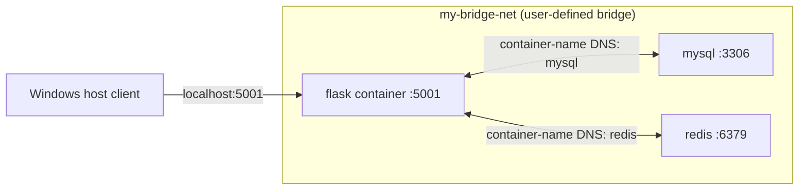

# Exercise 4: Docker Networking Lab

## Objective

Build and run a small Flask REST API alongside MySQL and Redis containers on a user-defined Docker bridge network. Verify published HTTP access, container-name DNS, and basic MySQL and Redis connectivity.

This exercise demonstrates network connectivity. The Flask `/about` endpoint does **not** query MySQL or use Redis.

## Prerequisites

- Windows 11 and VS Code PowerShell
- Docker Desktop running Linux containers
- Git (for the repository workflow)
- Internet access the first time Docker pulls the Python, MySQL, Redis, or diagnostic images

The lab uses Python 3.9 slim and the requested Flask 2.0.1 / Werkzeug 2.0.3 pins. Python 3.9 supports these versions, and the API uses only Flask's basic routing and JSON response features. No compatibility-driven deviation was needed.

## Project structure

```text
Exercise4/
|-- app.py
|-- requirements.txt
|-- Dockerfile
|-- Kubernetes_exercise_4_docker_networking.md
`-- screenshots/
```

## Architecture



The Flask container is the only service published to a host port. MySQL and Redis remain accessible to containers on `my-bridge-net`, but their ports are not published to the Windows host.

## Docker bridge networking

A bridge network connects containers on the same Docker host. A **user-defined** bridge network provides Docker embedded DNS, allowing a container to resolve another attached container by its name (for example, `mysql` or `redis`) rather than requiring a fixed IP. Network addresses, subnet, and gateway are assigned by Docker; inspect the actual values rather than assuming them.

## Flask API and container image

`app.py` implements `GET /about`, returning:

```json
{
  "name": "Simple REST API",
  "version": "1.0",
  "description": "This is a simple REST API built with Flask."
}
```

The development server listens on `0.0.0.0:5001`, so it accepts connections arriving through the container interface. The Dockerfile installs the pinned dependencies with `pip install --no-cache-dir -r requirements.txt`, exposes port 5001, and starts the application with Python.

## PowerShell implementation workflow

Run each stage and check the command output before continuing. Start from the repository root for the Git steps; use the Exercise4 folder for Docker build commands.

### 1. Inspect repository and Docker

```powershell
Set-Location 'C:\Users\LENOVO\Desktop\Devops'
git status --short --branch
git remote -v
docker info
```

Check existing Docker objects before creating anything with a potentially conflicting name:

```powershell
docker ps -a
docker network ls
```

Inspect any existing `flask-test`, `flask`, `mysql`, or `redis` container before deciding whether it is safe to reuse. Do not remove a container that belongs to another exercise.

### 2. Build and inspect the API image

```powershell
Set-Location 'C:\Users\LENOVO\Desktop\Devops\Exercise4'
docker build -t flask-api .
docker image inspect flask-api
```

Build output should finish successfully and the image inspection should return image metadata before running a container.

### 3. Test the image independently

First inspect whether `flask-test` already exists:

```powershell
docker ps -a --filter "name=^/flask-test$"
```

If no container is listed, run the independent test:

```powershell
docker run -d --name flask-test -p 5001:5001 flask-api
docker ps --filter "name=^/flask-test$"
docker logs flask-test
curl.exe http://localhost:5001/about
```

Expected HTTP JSON fields are `name`, `version`, and `description` with the values shown above. If the test container was created for this exercise, inspect it before removing it to free host port 5001 for the final `flask` container:

```powershell
docker inspect flask-test
docker stop flask-test
docker rm flask-test
```

Do not stop or remove a pre-existing `flask-test` without confirming that it is this exercise's disposable test container.

### 4. Create or reuse the custom network

```powershell
docker network ls
docker network inspect my-bridge-net
```

If the inspect command reports that `my-bridge-net` does not exist, create it and inspect it:

```powershell
docker network create --driver bridge my-bridge-net
docker network inspect my-bridge-net
```

If it exists already, inspect its driver and settings and reuse it when suitable. Record its actual driver, subnet, and gateway from the output. Do not remove an existing network.

### 5. Start MySQL and Redis

Check for containers with the requested names before creating them:

```powershell
docker ps -a --filter "name=^/mysql$"
docker ps -a --filter "name=^/redis$"
```

Reuse a suitable existing container attached to `my-bridge-net`. If a name is occupied by an unrelated or unsuitable container, stop and resolve the conflict with its owner; do not remove it as a shortcut.

When no conflicting containers exist, start MySQL:

```powershell
docker run -d --name mysql --network my-bridge-net `
  --env MYSQL_ROOT_PASSWORD=rootpass `
  --env MYSQL_DATABASE=devopsdb `
  --health-cmd="mysqladmin ping -h 127.0.0.1 -uroot -prootpass" `
  --health-interval=10s --health-timeout=5s --health-retries=10 `
  --health-start-period=30s `
  mysql:8.4
```

Start Redis:

```powershell
docker run -d --name redis --network my-bridge-net redis:7-alpine
```

Neither database port is published to the host. Check startup and wait for MySQL initialization:

```powershell
docker ps -a --filter "name=^/mysql$" --filter "name=^/redis$"
docker inspect --format '{{.State.Status}} {{if .State.Health}}{{.State.Health.Status}}{{end}}' mysql
docker logs mysql
docker logs redis
```

Wait until MySQL reports healthy before querying it. If MySQL has no health status yet or is still initializing, check `docker logs mysql` and retry the health check rather than issuing the database query prematurely.

### 6. Verify DNS and service connectivity

Use a temporary Python diagnostic container on the user-defined network. It uses Python's standard DNS and TCP APIs, so it does not assume `ping`, `getent`, Bash, or other diagnostic programs exist in the small Flask image:

```powershell
docker run --rm --network my-bridge-net python:3.9-slim python -c "import socket; [(print(f'{name} resolves to {socket.gethostbyname(name)}'), print(f'{name}: {socket.create_connection((name, port), timeout=5).getpeername()}')) for name, port in [('mysql', 3306), ('redis', 6379)]]"
```

Successful name resolution and TCP connections demonstrate that both container names resolve and their service ports are reachable on the Docker network. The resolved IP addresses are dynamic; record the ones actually printed.

### 7. Verify Redis and MySQL

```powershell
docker exec redis redis-cli ping
docker exec mysql mysql -uroot -prootpass -e "SHOW DATABASES;"
```

Expected Redis output is `PONG`. The MySQL output should include `devopsdb` and the standard system databases. The root password is a local disposable lab example, not a production credential.

### 8. Run the final Flask container

First check whether a container named `flask` exists:

```powershell
docker ps -a --filter "name=^/flask$"
```

Reuse a suitable existing Exercise4 container. If a different container owns that name, stop and resolve the conflict rather than removing it without approval. After the independent `flask-test` has been confirmed as the disposable Exercise4 test container and stopped/removed, run:

```powershell
docker run -d --name flask --network my-bridge-net -p 5001:5001 flask-api
docker ps
docker network inspect my-bridge-net
docker port flask
curl.exe http://localhost:5001/about
```

The three intended containers should be running and attached to `my-bridge-net`. `docker port flask` should show host port 5001 forwarded to container port 5001. The final request should return the same `/about` JSON as the independent test.

## Port publishing

The `-p 5001:5001` option maps TCP port 5001 on the Windows host to port 5001 in the Flask container. Thus `curl.exe http://localhost:5001/about` reaches the Flask service. MySQL and Redis need no host port mapping because the lab accesses them over the Docker bridge network.

## Observed results

These values were recorded from the actual Docker commands in this environment. The network addresses can change if containers are recreated.

| Verification | Observed result |
|---|---|
| Docker Engine | Docker Desktop Linux engine 29.8.1; `docker info` succeeded |
| Dockerfile dependencies | Inspected Dockerfile already contained the correct `RUN pip install --no-cache-dir -r requirements.txt`; no Dockerfile edit was necessary |
| Dependency pins | Flask 2.0.1 and Werkzeug 2.0.3 |
| Image build (`flask-api`) | `docker build --no-cache -t flask-api .` succeeded; image ID `sha256:594cb56e77b6` |
| Network driver, subnet, gateway | `my-bridge-net`: bridge; `172.18.0.0/16`; gateway `172.18.0.1` |
| Flask `/about` response | Passed. Returned `name: Simple REST API`, `version: 1.0`, and the requested description |
| Running container status | `flask`, `mysql`, and `redis` were running. MySQL reported healthy. Flask port `5001` was published; MySQL and Redis ports were not published to the host |
| Network DNS and TCP checks | Passed from Flask: `mysql` resolved to `172.18.0.2` and accepted TCP on 3306; `redis` resolved to `172.18.0.3` and accepted TCP on 6379 |
| Redis result | Passed: `PONG` |
| MySQL database list | Passed: output included `devopsdb`, `information_schema`, `mysql`, `performance_schema`, and `sys` |

The pre-existing `flask` container was inspected and found to use an older image ID. I recreated only that Exercise4 container using the newly built image; the existing `mysql`, `redis`, and `my-bridge-net` were preserved.

## Screenshots

Save only genuine captures of output from your running environment in `screenshots/`. Captured evidence:

- [Actual `/about` API response](screenshots/about-response.png), loaded from the rebuilt `flask` container.

The following terminal evidence has not been captured as screenshots yet:

1. Custom bridge network and its settings.
2. Successful `flask-api` image build.
3. Three intended running containers.
4. Network inspection with all three container memberships.
5. Diagnostic output resolving `mysql` and `redis`.
6. Redis `PONG`.
7. MySQL output listing `devopsdb`.

Capture those from the real PowerShell terminal if you need screenshot evidence for them. The successful command results above are verified, but are not represented as screenshots.

## Troubleshooting

- **Docker daemon unavailable:** Check Docker Desktop is running and retry `docker info`.
- **Build failure:** Read the first failing Docker build step. Check the Dockerfile, dependency pins, and network access before rebuilding.
- **Host port 5001 is already allocated:** Inspect `docker ps -a` and identify the process/container using the port. Do not remove an unknown container; use another port only if the lab requirements are adjusted.
- **Container name already exists:** Inspect it with `docker inspect <name>` and decide whether it is reusable. Do not remove unrelated containers.
- **MySQL is still initializing:** Check `docker inspect` health status and `docker logs mysql`; query only after initialization completes.
- **DNS name does not resolve:** Confirm both containers are running and attached to `my-bridge-net` with `docker network inspect my-bridge-net`.
- **TCP connection is refused:** Check target container status, service logs, and port. DNS resolving alone does not prove the service is ready.
- **`curl.exe` cannot connect:** Confirm `flask` is running, `docker port flask` shows the mapping, the app binds to `0.0.0.0`, and host port 5001 is free.
- **Redis or MySQL command fails:** Inspect the corresponding container status and logs first; do not reset Docker or remove volumes/networks as a troubleshooting shortcut.

## Beginner interview questions

1. **What is a Docker bridge network?**

    A virtual network that lets containers on one Docker host communicate.

2. **Why use a user-defined bridge instead of only the default bridge?**

    A user-defined bridge provides automatic container-name DNS and can be inspected and managed as a separate network.

3. **What does Docker embedded DNS do?**

    It resolves container/service names such as `mysql` to their current container IPs on that network.

4. **Why can Flask connect to `mysql` without a fixed IP?**

    Both containers are attached to the same user-defined network, where Docker resolves the name.

5. **What does `-p 5001:5001` mean?**

    It forwards host TCP port 5001 to container TCP port 5001.

6. **Why bind Flask to `0.0.0.0`?**

    It listens on all container interfaces, including the interface Docker forwards traffic to.

7. **Why are MySQL and Redis not published to host ports here?**

    The lab only requires the Flask API on the host; the database/cache connectivity checks run over the internal Docker network.

8. **Does the `/about` endpoint use MySQL or Redis?**

    No. It returns static API metadata. Separate diagnostic commands verify network access to those services.

9. **What is a container health check useful for?**

    It reports whether the service is ready according to a configured check, rather than merely whether its process exists.

10. **Why inspect a container before removing it?**

    Its name or ownership may belong to another exercise; inspection prevents accidental removal of unrelated work.

11. **Does DNS resolution alone prove MySQL is ready?**

    No. It confirms name resolution. A TCP check and MySQL health/status check are also needed.

12. **Should the sample root password be used in production?**

    No. It is a local lab credential; production secrets must be managed securely.

## Conclusion

This lab demonstrates Docker image building, user-defined bridge networking, container-name discovery, and host port publishing. It also verifies MySQL and Redis independently. The Flask API remains deliberately small: network reachability does not imply application-level database or cache integration.
